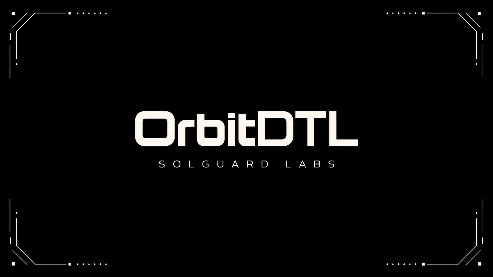
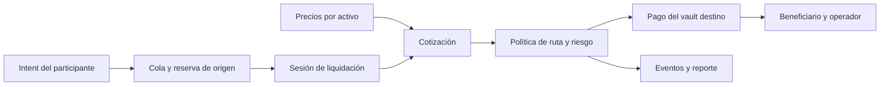

# OrbitDTL



OrbitDTL es un motor de liquidación diferida multi-activo. Coordina intents,
vaults, rutas, sesiones, precios de oráculo y límites de riesgo en un binario
Rust. Su salida JSON determinista sirve para conciliación y herramientas de
operación sin dependencia de servicios externos.

## Flujo de liquidación



Cada intent identifica activos, vaults, beneficiario, mínimo recibido, nonce
y vencimiento. La ruta define límites y comisión. Una sesión agrupa operaciones
en un slot lógico; el origen consume la reserva y el destino paga el importe
bruto autorizado. El beneficiario recibe el neto y el operador la comisión.

## Inicio rápido

Requisitos: Rust estable con Cargo, Bun 1.3.14+ y sus respectivas toolchains.

```bash
bun install --frozen-lockfile
cargo run --locked -- demo
cargo run --locked -- demo --json > report.json
bun run inspect report.json
bun run test:all
```

`report.json` contiene cuentas, vaults, sesiones y eventos. El inspector
`client/report-client.mjs` agrega saldos y pagos por activo como cadenas
decimales para no convertir los agregados a números de coma flotante.

## Cálculos principales

La cotización usa precios escalados a `10^8` y decimales de cada activo:

```text
importe_destino = floor(importe_origen × precio_origen × 10^dec_destino
                        / 10^dec_origen / precio_destino)
comisión = floor(importe_destino × (fee_bps + relayer_bps) / 10_000)
neto = importe_destino - comisión
```

Los productos y sumas de `Amount` se comprueban contra overflow. Antes del
pago, el motor contrasta límites de ruta, cuenta y sesión; después genera
`IntentSettled`. Consulte [modelo económico](./docs/modelo-economico.md) para
un ejemplo con unidades mínimas y reglas de redondeo.

## Verificación

```bash
bash scripts/ci.sh
```

CI ejecuta `cargo fmt`, build, tests Rust, Clippy, formato y sintaxis
JavaScript, y tests de integración Bun en Ubuntu y Windows. La rama
`production` y el tag anotado `v1.0.0` corresponden a la revisión de
`Production 1.0.0` en `main`.

- [Arquitectura](./docs/arquitectura.md)
- [Modelo económico](./docs/modelo-economico.md)
- [Operación y conciliación](./docs/operacion.md)
- [Seguridad](./SECURITY.md)

`src/` contiene el motor, `client/` la lectura de reportes, `tests/` los
contratos de integración y `scripts/` las verificaciones reproducibles.
