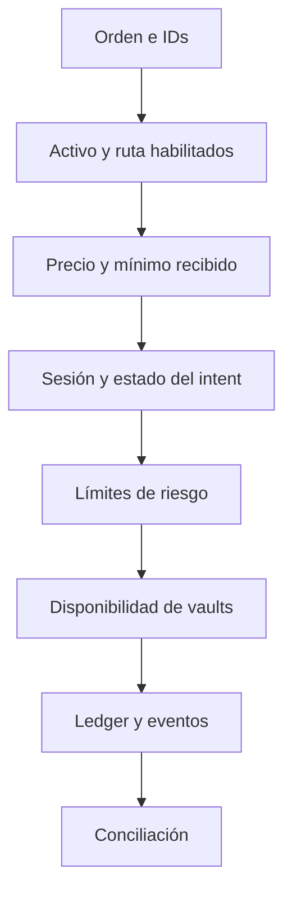

# Seguridad de OrbitDTL

## Límites del sistema

El binario opera sobre un ledger determinista: activos, precios, cuentas,
vaults, rutas e intents registrados en memoria. La CLI de ejemplo no administra
claves, no firma transacciones y no conecta con redes externas. Los reportes
JSON son datos de operación; nunca deben tratarse como autorización de pago.

## Controles comprobables

- Los importes usan `u128` y operaciones aritméticas comprobadas.
- Una ruta enlaza activos y vaults concretos y puede deshabilitarse.
- Cada intent tiene mínimo de salida, vencimiento, nonce y estado de cola.
- Un vault distingue reserva, saldo bloqueado, entradas y pagos.
- La autorización de riesgo evalúa límites de ruta, cuenta y sesión antes de
  mover saldos.
- Los eventos permiten reconstruir alta, cola, cancelación y liquidación.

Una prueba aislada de no negatividad no acredita toda la secuencia: la revisión
debe incluir transiciones y conciliación por activo. El cliente de reportes
rechaza enteros JSON inseguros y pagos cuyos importes bruto, neto y comisión
no concilian.

## Revisión y comunicación

Para una incidencia técnica, adjuntar revisión Git, comando, escenario,
precondiciones, saldos antes/después, IDs relacionados y resultado esperado.
Evitar secretos y datos de terceros en issues públicos. Antes de aceptar
cambios se ejecutan los controles de [operación](./docs/operacion.md) y CI en
PR, `main`, `production`, tag y release.
