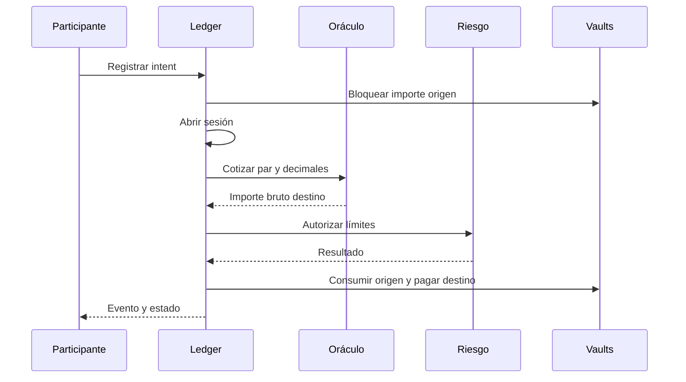

# Arquitectura

## Componentes

`asset` registra decimales y parámetros; `oracle` cotiza entre activos;
`routes` define vaults, operador y límites; `orders` mantiene intents en cola;
`session` agrupa liquidaciones; `risk` autoriza nocionales; `ledger` coordina
transiciones; `events` deja rastro serializable. `amount` encapsula `u128` y
operaciones comprobadas. `cli` expone la ejecución reproducible.

Los IDs de cuenta, activo, vault, ruta, intent y sesión son tipos distintos.
El slot lógico avanza en cada liquidación. Una orden cancelada libera su saldo
bloqueado; una liquidada no puede volver a ser procesada como pendiente. El
reporte de ejemplo contiene mapas por ID y una lista ordenada de eventos;
las herramientas deben relacionarlos por identificador, no por posición.

## Estados y alcance del reporte

La CLI publica `demo` en texto o JSON. El JSON contiene `accounts`, `vaults`,
`sessions` y `events`, pero no es un volcado completo de todas las estructuras
internas del ledger. Una sesión cerrada describe su ventana operativa; los
pagos efectivos deben conciliarse además con los eventos y los vaults.
