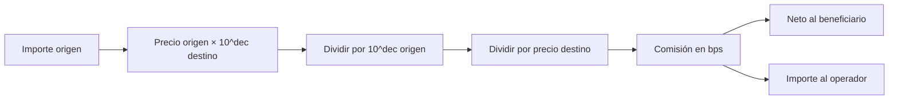

# Modelo económico

## Unidades y cotización

Los importes son enteros en unidades mínimas del activo. El oráculo representa
precios con escala `10^8`; el motor ajusta por los decimales de origen y
destino usando divisiones enteras sucesivas. Para `12_000_000_000` unidades
mínimas de un activo de seis decimales a precio `100_000_000`, contra otro de
seis decimales a `108_000_000`, la cotización bruta es `11_111_111_111`.
La pérdida fraccional queda truncada, no acumulada en una cuenta implícita.

El `gross_out` se reduce por `floor(gross_out × total_fee_bps / 10_000)`.
El neto debe satisfacer el mínimo del intent. El origen consume el importe
reservado; el vault destino paga el bruto. La cuenta beneficiaria recibe el
neto y el operador recibe la comisión: `bruto = neto + comisión`.

## Capacidad

La ruta fija `max_unhedged` y `session_limit`; el motor de riesgo también
agrega nocional por cuenta y por sesión. La disponibilidad del vault se define
como `max(0, reserve - locked)`. Un reporte de eventos permite sumar pagos,
pero la decisión de autorización pertenece al ledger y debe verificarse en
su estado y orden temporal, no solo con una suma al final.

El cliente de lectura emplea `BigInt` para agregar importes y serializa los
totales como texto decimal. Rechaza números JSON superiores a
`Number.MAX_SAFE_INTEGER` porque ya podrían haber perdido precisión al
parsearse; para importes mayores se necesita un transporte decimal explícito.
